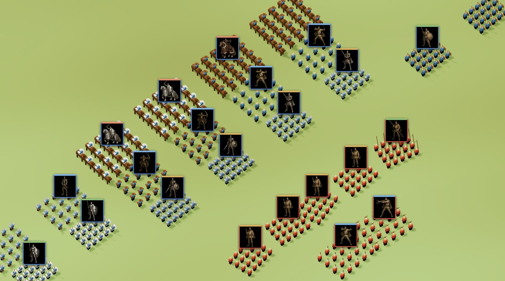
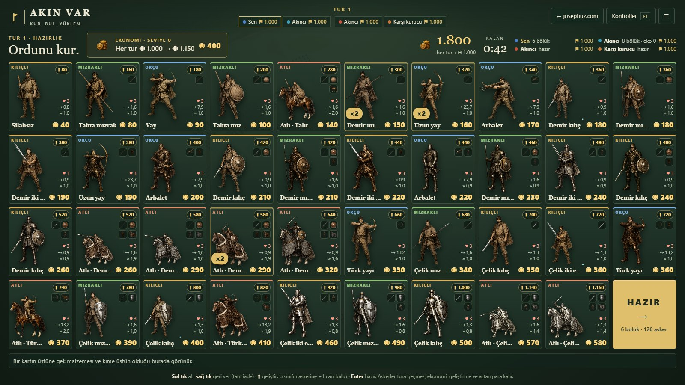
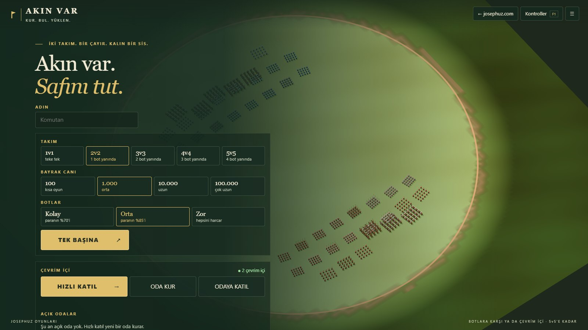

# Akın Var

> **EN:** A round-based team army battle in the browser (Three.js), inspired by Total War with Throne of Curse combat: build your army from cards, fight in a shrinking ring under fog, then storm the enemy flags; up to 5v5 with bots or in an online room.
>
> **TR:** Tarayıcıda (Three.js) Total War esintili, tur tabanlı takım ordu savaşı, dövüşü Throne of Curse'ten: ordunu kartlarla kur, sisli ve daralan çemberde savaş, sonra rakip bayraklara yüklen; 5v5'e kadar botlarla ya da çevrim içi odada.

**Play / Oyna:** https://akinvar.josephuz.com · **Source / Kaynak:** https://github.com/JosephUz/akinvar

 

Tarayıcıda Three.js ile çalışan, Total War esintili, tur tabanlı takım ordu savaşı. Savaş mantığı Throne of Curse'ten gelir. Tasarım: [docs/oyun-fikri.md](docs/oyun-fikri.md).

## Başlatma

`Baslat.cmd` dosyasına çift tıklayın ya da bu klasörde `npm start` çalıştırın, ardından http://localhost:5240 adresini açın. Node.js gerekir; ilk seferde `npm install` (yalnız `ws`). Three.js 0.180 `vendor/` içinde.

- `?asker=10000`: asker sayısı (en çok 20.000)
- `?golge=0`: gölgeler kapalı
- `?tohum=7`: savaş tohumu (aynı tohum aynı savaşı verir)

## Geliştirme

- `npm test`: simülasyon testleri
- `npm run olcum`: tarayıcısız simülasyon başarım ölçümü (2/5/10/20 bin asker)

## Durum

- **Faz 0 (başarım):** bölük düzeyi belirlenimci simülasyon, InstancedMesh çizim. RTX 5080'de 20.000 askerle 60 kare/sn.
- **Faz 1 (tek savaş, bota karşı):**
  - Çember arena, sis (bölükler yalnız çevresini görür), 30 sn sonra daralan alan (dışarıda kalan can kaybeder).
  - Seçim: tek tık, kutu, çift tık aynı tür, 1 / 2 türe göre, Ctrl A hepsi.
  - Emir: sağ tık yürü / saldır, Boşluk dur. Bot sisin içinde arar.
  - Ana ekran, Esc menüsü, maç sonu. F3 başarım paneli.

- **Faz 2 (tur döngüsü):**
  - Ana ekranda takım (1v1–5v5, boş koltuklar bot) ve bayrak canı (100 / 1.000 / 10.000 / 100.000).
  - Hazırlık (45 sn): tam ekran kart ızgarası. Ekonomi (400 × n, tur başı +150) ve sınıf başına Geliştir (+1 can, her seviye tur gelirinin yarısı: ◉1.000 → ◉500, ◉1.150 → ◉575) kalıcı; throneofcurse'ün 39 sınıfı 4 × 10 ızgarada, her tık bir bölük, sağ tık tam iade.
  - Savaş: throneofcurse üstünlük tablosu, arkadan vuruş +20, menzil, vuruş aralığı, atlı ve zırh hızı. Okçular ok atar; Türk yaylı atlı okçular vur-kaç yapar (yürürken atar, yakın dövüşçüden çekilir).
  - Savaşta ölen her asker kendi bayrağından bir can götürür (kazanan da kaybeden de).
  - Bayrak evresi (20 sn): kazananların sağ kalanları seçilen rakip bayrağa koşar, her biri bir can götürür; gönderilmeyen dağılır.
  - Bot kişilikleri: Açgözlü, Akıncı, Dengeli, Karşı kurucu.
  - Tek başına maç tarayıcıda kendiliğinden kaydedilir (hazırlık, savaşın ortası, bayrak evresi; birkaç saniyede bir ve sekme kapanırken). Ana ekranda Devam et kaldığı yerden açar, maç bitince kayıt silinir.

- **Faz 3 (çevrim içi ve hazırlık arayüzü):**
  - josephuz oda standardı: ADIN, tek başına, ÇEVRİM İÇİ (hızlı katıl, oda kur, odaya katıl), açık odalar, bekleme odası (Mavi / Kırmızı koltuklar, takım, bayrak canı, bot zorluğu, açık / özel), davet linki ?oda=KOD, jetonla geri dönüş, kopanın yerine bot.
  - Maçı sunucu yürütür (20 Hz); istemci savaşı sunucunun adımları ve emirleriyle aynen koşar, 3 sn'de bir ikili anlıkla düzeltir.
  - Savaş: her bölüğün üstünde siyah zeminde asker görselli sancak (askerlerin çizilen konumunu her karede izler), üstü aile renginde, çerçevesi oyuncu renginde; kalkan, miğfer, omuzluk ve silah malzemesine göre boyalı (tahta/deri kahve, demir gri, çelik parlak). Seçilen bölükler sol altta sınıf sınıf deste kartı (×n, kalan asker çubuğu).
  - Hazırlık: throneofcurse asker görselleri ve eşya ikonlu kartlar, en ucuz sol üstte, sınıf başına Geliştir, bilgi şeridi (malzeme, üstün / zayıf olduğu sınıflar).
  - Fiyatlar throneofcurse üretim tariflerinden (odun, demir, çelik, deri, yem).
  - Emirsiz bölükler botun yapay zekâsıyla savaşır; bot zorluğu Kolay / Orta / Zor.

Sunucuyu başlat: Unknown command: "start"

Did you mean one of these?
  npm star # Mark your favorite packages
  npm stars # View packages marked as favorites
  npm start # Start a package
To see a list of supported npm commands, run:
  npm help (çevrim içi odalar aynı portta, ws). Henüz Docker ve tunnel yok.

## Dil

Türkçe + İngilizce (josephuz/docs/dil-standardi.md): `src/dil.js` ortak modül, sözlükler `src/diller/tr.js` ve `en.js`, `npm run dil` denetler. Dil tarayıcıya göre açılır, `?dil=en` ya da sağ üstteki EN / TR düğmesiyle değişir. Sınıf, takım ve bot adları ortak dosyalarda (sunucu da kullanır) anahtar olarak durur, arayüzde çevrilir.

## Yayın

- İstemci: Cloudflare Worker, `akinvar.josephuz.com` → `npm run deploy:web`
- Sunucu: Docker + Cloudflare Tunnel, `akinvar-sunucu.josephuz.com` → `docker compose --profile tunnel up -d --build`
  (`.env` içinde `TUNNEL_TOKEN`, paneldeki rota `http://localhost:5240`).
- itch.io: `npm run itch` → `artifacts/akinvar-itch.zip`; sayfa metni ve görseller [docs/itch/](docs/itch/sayfa.md).

## Lisans / License

- **Kod:** [MIT](LICENSE), Copyright (c) 2026 JosephUz. Kodu kullanabilir, değiştirebilir, dağıtabilirsin.
- **MIT dışında, tüm hakları saklıdır:** "Akın Var" ve "JosephUz" adları, logo ve simgeler, `img/` altındaki asker görselleri ve eşya ikonları (Throne of Curse). Ayrıntı: [TRADEMARKS.md](TRADEMARKS.md).
- **Üçüncü taraf:** `vendor/` altındaki [three.js](https://github.com/mrdoob/three.js) MIT lisanslıdır (`vendor/THREE-LICENSE.txt`).

> **In English:** The code is licensed under [MIT](LICENSE). The names "Akın Var" and "JosephUz", the logo and icons are **not** covered by MIT and are all rights reserved; see [TRADEMARKS.md](TRADEMARKS.md). Forks must use a different name and logo.

## Katkı / Contributing

Hata bildirimi, öneri ve pull request'e açığız. Büyük bir değişiklikten önce bir [issue](https://github.com/JosephUz/akinvar/issues) açıp konuşalım; oyunun dengesi ve yönü JosephUz'da. Kod ve oyun Türkçe: değişken, işlev ve mesaj adları Türkçe, çevresindeki kodun düzenine uy; `npm test` geçmeli. Gönderdiğin katkı bu deponun MIT lisansıyla yayımlanır. Görsel eklemeden önce issue'da sor. Güvenlik açıklarını issue yerine [SECURITY.md](SECURITY.md)'deki yoldan bildir.

> **In English:** Issues and pull requests are welcome; please open an issue before large changes. Contributions are accepted under the MIT license of this repository. Report security issues privately as described in [SECURITY.md](SECURITY.md).
